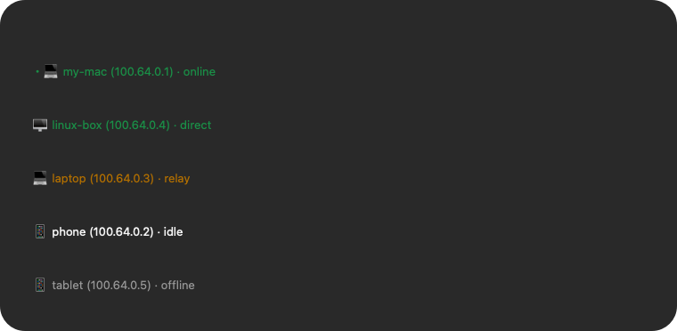

# Tailnet Status — SwiftBar plugin

[](https://github.com/seudut/tailscale-swiftbar/actions/workflows/ci.yml)

Show every device in your Tailscale / Headscale tailnet in the macOS menu bar,
using the same connection classification as `tailscale status` (compact:
`direct` / `relay` / `peer-relay` / `idle` / `-` / `offline`), with one-click
SSH / Screen Sharing / Ping / Copy IP actions.

The plugin reads the local `tailscaled` unix socket (`tailscale status --json`)
only — no sudo, no network calls of its own, no GUI Tailscale app required.

## Preview

Menu bar: **Tailscale dot mark + online/total**.


Dropdown:



```
---
・💻 my-mac (100.64.0.1) · online
🖥️ linux-box (100.64.0.4) · direct          [green]
💻 laptop (100.64.0.3) · relay              [orange]
📱 phone (100.64.0.2) · idle
📱 tablet (100.64.0.5) · offline            [gray]
---
Headscale: https://headscale.example.com
Full status          → run `tailscale status` in Terminal
Refresh              → ping all online peers, then refresh
Open plugin folder
```

- inline 18×18 vector PDF icon as a `templateImage` (adapts to light/dark menu
  bar and Retina, no external image files)
- device icons: 💻 macOS, 🖥️ linux, 📱 iOS/iPadOS/Android, ❓ unknown
- colors: `direct` green, `relay` orange, `offline` gray, `idle` / `-` default

## Status column

The classification is the same as the last column of `tailscale status`
(`Online` / `Active` / `CurAddr` / `Relay` / `PeerRelay` / traffic counters),
but only the keyword is displayed:

| Display | Meaning | Color |
|---|---|---|
| `direct` | an active direct path exists | green |
| `relay` | active connection goes through DERP | orange |
| `peer-relay` | active connection goes through a peer relay | orange |
| `idle` | online, no active connection (has had traffic) | default |
| `-` | online, no active connection and no traffic info | default |
| `offline` | not connected at all (exact `last seen` in the submenu) | gray |

The plugin also auto-detects the control URL from `tailscale debug prefs`
(override with `TAILNET_CONTROL_URL`).

## Refresh and keepalive

- **Auto refresh**: every 10 seconds, the plugin reads a fresh
  `tailscale status --json` snapshot (read-only, no packets).
- **Background keepalive** (new in v1.14): every 60 seconds, it pings all online
  peers in the background (`tailscale ping -c 1 --timeout=1s`, in parallel) so
  direct paths stay warm and status doesn't fall back to `-` / `idle`.
  Disable with `TAILNET_KEEPALIVE=0`.
- **Manual Refresh** menu item: pings all online peers once, waits for them, then
  immediately reruns the plugin so the menu shows the freshly established paths.
- Direct/relay is dynamic: after the keepalive, statuses normally settle on
  `direct` (green) or `relay` (orange, when NAT traversal is impossible).

## Install

1. Install SwiftBar: `brew install --cask swiftbar` (or from swiftbar.app).
2. Install the plugin — either:

   ```sh
   # from a checkout / release zip
   sh install.sh

   # or one-liner
   curl -fsSL https://raw.githubusercontent.com/seudut/tailscale-swiftbar/main/install.sh | sh
   ```

3. No sudo needed. The script copies `tailnet.10s.py` into
   `~/Library/Application Support/SwiftBar/Plugins/`, makes it executable and
   starts/refreshes SwiftBar.
4. Optional: SwiftBar menu → Preferences → *Launch at Login*.

## Configuration

Environment variables (or edit the constants at the top of the plugin):

| Variable | Default | Description |
|---|---|---|
| `TAILNET_SSH_USER` | current user | SSH action user |
| `TAILNET_CONTROL_URL` | auto from `tailscale debug prefs` | Headscale link in the footer |
| `TAILNET_TS_BIN` | auto-detect Homebrew `tailscale` | CLI path |
| `TAILNET_LANG` | `auto` (system language) | `auto` / `en` / `zh` |
| `TAILNET_KEEPALIVE` | `60` | seconds between background keepalive pings; `0` disables |

Language: menu text follows the system language; status keywords stay in English
(consistent with `tailscale status`). Force with `TAILNET_LANG=en|zh`.

## Troubleshooting

- **Menu shows only SwiftBar’s standard items**: SwiftBar 2.x body lines must be
  plain `title | params`; `--` means “submenu of the previous item”. (Fixed in
  v1.1; see `CONTRIBUTING.md`.)
- **Menu bar icon missing**: restart SwiftBar; the icon is an inline base64 PDF.
- **Check output locally**:
  ```sh
  "/Users/$USER/Library/Application Support/SwiftBar/Plugins/tailnet.10s.py"
  ```
- **Different refresh interval**: rename the plugin, e.g. `tailnet.5s.py`.
- Device menu positions: hold ⌘ and drag the menu bar item.

## Development

```sh
python3 -m py_compile tailnet.10s.py
python3 tests/validate_swiftbar.py   # fake tailscale CLI, format/status checks
sh -n install.sh
```

See [CONTRIBUTING.md](CONTRIBUTING.md) and [CHANGELOG.md](CHANGELOG.md).

## License

[MIT](LICENSE)
